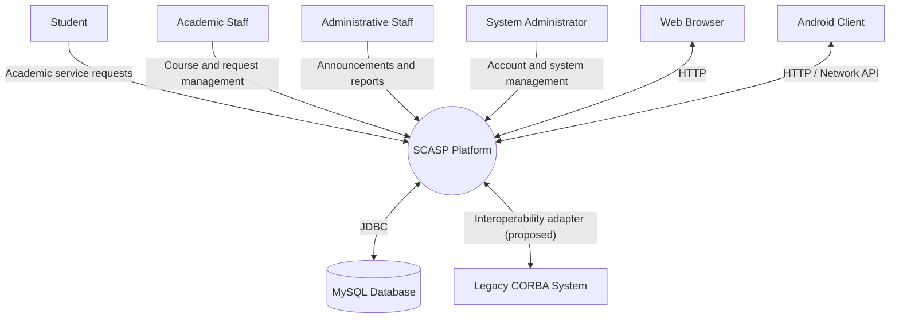
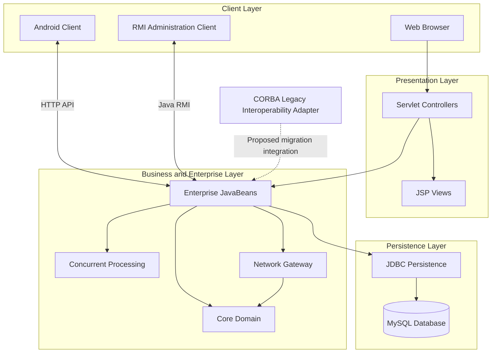
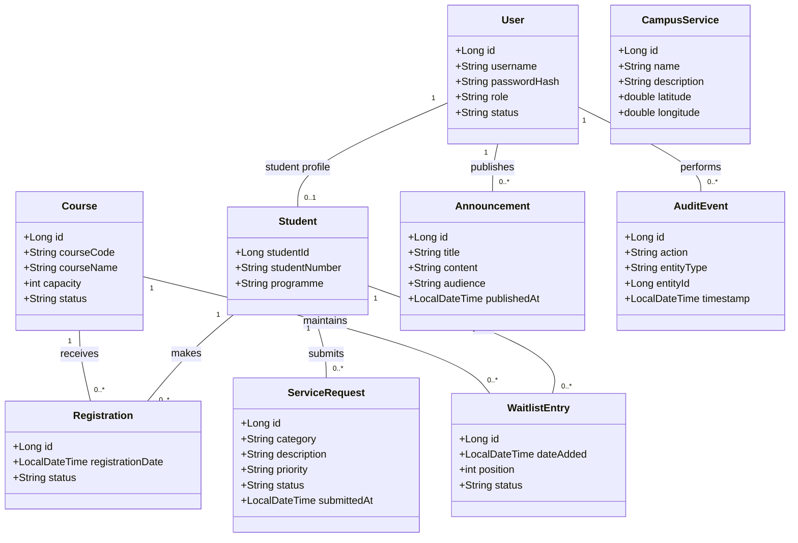

# SCASP — Architecture Baseline

**Project:** Smart Campus Academic Services Platform  
**Course:** BoCS3100 — Advanced Java  
**Institution:** National Institute of Public Administration (NIPA)  
**Version:** 1.0  
**Date:** 3 November 2026

---

## 1. Introduction

This document describes the initial software architecture of the Smart Campus Academic Services Platform (SCASP).

The architecture defines the major system components, their responsibilities, communication relationships and the core domain entities.

SCASP will use a modular architecture in which individual components handle specific responsibilities while communicating through clearly defined interfaces.

The system will support web-based, mobile and distributed access to academic services.

## 2. Architectural Objectives

The architecture is designed to:

1. Separate business logic, data access and user interfaces.
2. Support multiple users and concurrent operations.
3. Provide reliable communication between distributed components.
4. Maintain consistent academic records.
5. Support both web and Android clients.
6. Demonstrate the Advanced Java technologies required by the assignment.
7. Allow components to be tested and maintained independently.

## 3. System Context Diagram

The context diagram illustrates SCASP's relationship with its external users and systems.

### Context Diagram Explanation

- **Students:** Access courses, register, withdraw, submit service requests and view announcements.
- **Academic Staff:** Manage courses and process academic service requests.
- **Administrative Staff:** Publish announcements and generate reports.
- **System Administrators:** Manage accounts, roles and system operations.
- **Web Browser:** Provides access to the web application.
- **Android Client:** Provides mobile access to selected academic services.
- **MySQL Database:** Stores application records.
- **Legacy CORBA System:** Represents a possible legacy service for which interoperability and migration will be analysed.

The CORBA connection represents a proposed interoperability design. It does not imply that a real legacy CORBA system is already available.

## 4. Component Architecture

SCASP will be organized into the following major components.

### 4.1 Core Domain

**Directory:** `core-domain/`

Responsibilities:

- Define the main domain entities.
- Represent students, courses and registrations.
- Define business rules and validation.
- Maintain consistent domain identifiers.
- Provide reusable domain objects for other components.

### 4.2 Concurrent Processing

**Directory:** `concurrent-processing/`

Responsibilities:

- Process multiple tasks concurrently.
- Manage background processing.
- Use ExecutorService and appropriate thread-management mechanisms.
- Handle task timeouts, interruptions and rejected tasks.
- Demonstrate safe access to shared resources.
- Maintain processing statistics.

### 4.3 Network Gateway

**Directory:** `network-gateway/`

Responsibilities:

- Provide TCP-based communication.
- Process supported network commands.
- Support UDP-based announcements or heartbeat messages.
- Retrieve information through URL-based communication.
- Handle multiple clients and network failures.

### 4.4 Enterprise Services

**Directory:** `enterprise-services/`

Responsibilities:

- Coordinate business operations.
- Implement enterprise JavaBeans.
- Provide service methods for course registration and academic requests.
- Manage transactions through the enterprise container.
- Support dependency injection and enterprise service lifecycle management.

### 4.5 JDBC Persistence

**Directory:** `persistence-jdbc/`

Responsibilities:

- Connect to the MySQL database.
- Execute database operations using JDBC.
- Provide CRUD operations.
- Manage database transactions.
- Generate reports.
- Store audit records.

### 4.6 Web Application

**Directory:** `web-application/`

Responsibilities:

- Provide browser-based access.
- Implement HTTP request handling using Servlets.
- Manage user sessions.
- Validate incoming requests.
- Enforce access restrictions.

### 4.7 JSP Presentation

The JSP presentation layer will provide the web application's user interface.

Responsibilities:

- Display course information.
- Display registration records.
- Present academic service requests.
- Display announcements and reports.
- Provide reusable page fragments.
- Use Expression Language (EL) and JSTL/Jakarta Tags rather than Java scriptlets.

### 4.8 RMI Administration

**Directory:** `rmi-administration/`

Responsibilities:

- Provide remote administration operations.
- Define remote interfaces.
- Exchange serializable data-transfer objects.
- Support communication between separate Java processes.
- Handle remote communication exceptions.

### 4.9 Android Client

**Directory:** `android-client/`

Responsibilities:

- Provide mobile login.
- Display available courses.
- Support course registration.
- Display academic service requests.
- Display campus services.
- Communicate with the server through a network API.
- Handle application lifecycle and runtime location permissions.

### 4.10 CORBA Migration Documentation

**Directory:** `docs/corba-migration/`

Responsibilities:

- Define a sample CORBA interface using IDL.
- Explain ORBs, object references, naming and generated stubs.
- Compare CORBA with Java RMI and HTTP-based services.
- Propose an adapter or facade for migration to modern interfaces.

## 5. Initial Component Diagram

### Component Interaction Explanation

1. A student accesses SCASP through a browser or Android application.
2. The web application receives browser requests through Servlets.
3. Servlets communicate with enterprise services to execute business operations.
4. Enterprise services use core-domain objects to enforce business rules.
5. Concurrent processing supports simultaneous tasks.
6. Network gateway services support distributed communication.
7. JDBC persistence retrieves and stores information in MySQL.
8. The RMI client accesses supported remote administration operations.
9. CORBA interoperability is addressed through a proposed adapter and migration design.

## 6. Domain Model

The domain model identifies the main entities and their relationships.

### 6.1 Main Domain Entities

| Entity | Description |
|---|---|
| User | Represents an authenticated system user. |
| Student | Represents a student using academic services. |
| Course | Represents an academic course. |
| Registration | Records a student's registration in a course. |
| WaitlistEntry | Represents a student's position on a course waiting list. |
| ServiceRequest | Represents an academic service request. |
| Announcement | Represents an institutional announcement. |
| AuditEvent | Records important system activities. |
| CampusService | Represents a service or facility available on campus. |

### 6.2 Domain Class Diagram

### 6.3 Domain Model Explanation

**User and Student**

A User represents an account in the platform. A Student represents the academic profile associated with a student account.

**Course and Registration**

A Course represents an academic subject offered by the institution. Registration connects a student to a course.

The system must prevent duplicate active registrations and enforce course capacity.

**WaitlistEntry**

When a course reaches its maximum capacity, eligible students may be placed on a waiting list.

**ServiceRequest**

Students use ServiceRequest to submit academic or administrative requests. Staff can assign, prioritize and update their status.

**Announcement**

Announcements allow authorized staff to communicate information to selected audiences.

**AuditEvent**

AuditEvent records important actions performed by users, including the actor, affected entity, action and timestamp.

**CampusService**

CampusService represents facilities such as the library, administration office, laboratory or student services office.

## 7. Architectural Constraints and Design Decisions

1. Java 21 will be used as the primary programming language.
2. Maven will manage project builds and dependencies.
3. MySQL will provide relational database storage.
4. JDBC will be used for database persistence.
5. Enterprise JavaBeans will demonstrate enterprise business services.
6. Servlets and JSP will provide web functionality.
7. Java RMI will demonstrate remote method invocation.
8. Android Studio will be used to develop the mobile client.
9. CORBA will be addressed through an interoperability and migration design.
10. Git and GitHub will support collaboration and version control.

## 8. Initial Security Considerations

- User passwords must not be stored as plain text.
- Protected operations must enforce role-based authorization.
- Database operations must use prepared statements.
- User input must be validated.
- Session management must prevent unauthorized access.
- Sensitive configuration values must not be committed to GitHub.

## 9. Conclusion

This architecture provides the initial structural foundation for SCASP.

It separates client interfaces, business services, domain logic, networking and persistence while allowing the required Advanced Java technologies to be demonstrated within one integrated academic services platform.

The architecture will be refined as implementation and integration progress.

**Prepared by:** SCASP Project Team  
**Status:** Initial architecture baseline